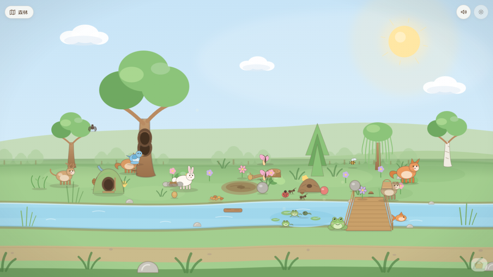
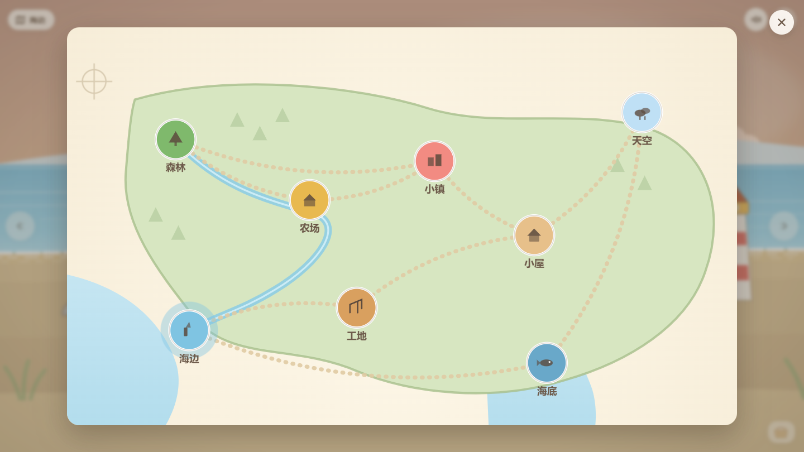
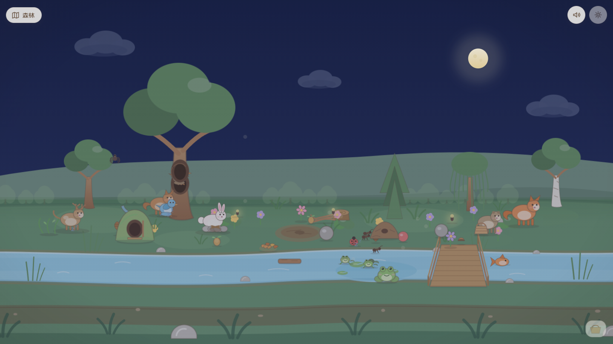
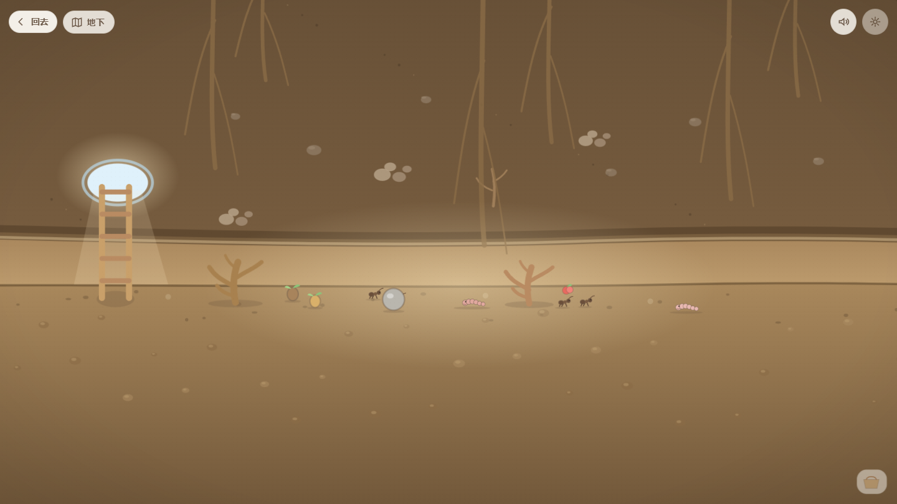
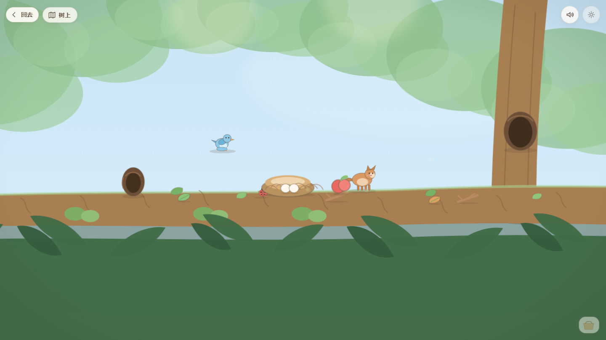

# Little World · 小小世界

面向 3—5 岁儿童的自由探索型开放世界。八个连在同一张手绘地图上的区域，可以搬东西、种东西、组合东西、造东西，也可以什么都不做。其中四个还藏着“里面”：农场的谷仓、海底的沉船、森林的地下与树上。

没有任务、没有分数、没有倒计时、没有失败、没有排行榜、没有广告。



---

## 打开它

**最省事**：双击项目根目录的 **`小小世界.html`**（单文件，`file://` 直接可玩，声音与存档都正常）。

**Windows 开发**：双击 `start-dev.bat`，自动开服务器并打开浏览器。

**命令行**：

```bash
npm install          # Node 18+
npm run dev          # http://127.0.0.1:5173
npm run build        # 生产构建 → dist/
npm run build:single # 单文件版 → standalone/index.html（记得复制成 小小世界.html）
```

---

## 现在有什么

八个区域：**森林 · 农场 · 海边 · 小镇 · 小屋 · 工地 · 海底 · 天空**，由道路与河流连在一张地图上。竖屏手机会自动换成两列四行的书页地图，节点直径 85px。

每个地方都还有「里面」：点地上的**兔子洞**钻进森林**地下**（蚂蚁、蚯蚓、树根），点大树的**树洞**爬到**树上**（鸟巢、鸟蛋、松鼠、果实），推开农场的**谷仓门**进去（草垛、木箱、猫，还有一只夜里才醒的猫头鹰），从海底的**洞穴**游进**沉船**（船肋、破渔网、章鱼）。每个里层都有一把梯子可以出来。

**整个世界会自己运转**：下雨会把土打湿，花开会招来蜜蜂，蜜蜂采过蜜才会结果，落叶堆会慢慢烂成肥土，松鼠会把松果搬回树洞，蝌蚪会自己长出腿。海边有潮汐，涨潮落潮会露出或藏起沙滩上的东西；农场的鸡会下蛋；海底的气泡会往上飘。孩子不碰它也在变；孩子动了，变的方向就不一样了。

**天也会自己黑**：常速下两分钟一个昼夜（日出 → 白天 → 日落 → 夜晚），四个昼夜换一季。每一天按当季的脾气掷一次天气——春天雨多、夏天以晴为主（**根本没有雪这一项**）、秋天风大、冬天雪最多。孩子开着页面什么也不做，也能看到天黑、下雪、换季。

**换地方有三条路**：左上角的地图、直接在**空白处左右一划**、或者点画面左右两边的**翻页箭头**——往左看右边那个区域，往右看左边那个，八个区域首尾相接。手里拖着东西时划动只搬东西，不会换地方。

**画风是一本自然图鉴**：每样东西只用两三个平色，但形状按真实的来——树干有体积和树皮纹，叶子是一片片带侧脉的橡树叶，兔子是坐着的野兔，蝴蝶有前后翅和翅脉。动物往左走时整只会转过去（0.3 秒），点它不会翻跟头。

**世界是有人住的**：狐狸凑近兔子，兔子撒腿就跑；猫走近小鸡，小鸡扑腾着躲开。溪边一排石头、沙滩上一排贝壳、船舱里一排玻璃瓶，敲一敲发出 do re mi sol la——孩子会自己找出顺序。有些东西要等：潮水退下去才露出来的、要连点三下才开的。离开一阵再回来，你走的地方会多一样东西（雨天的蜗牛、雪天的断枝、秋天的一片叶子）。

七个核心机制：

- **随意搬运**：100+ 个可拖实体，拿起变大有影子，落点分地面 / 叠放 / 水面。拖到右下小篮子可以带去别的区域。
- **物品组合**：56 条规则全凭拖放（橡果+种子→植物、种子+泥地→种下、树枝+树枝→落叶堆、树枝+火堆→篝火、蘑菇+篮子→装满、面粉+水壶→面团、木板+木板→桥…）。组合不了就安静落地，不弹提示。
- **自然生长**：种子→土坑→芽→幼苗→成株→开花→结果 六段，长得快慢取决于土壤湿度、日照、季节和肥力。花开着不授粉就不会结果——蜜蜂和蝴蝶真的会飞过来。鸡蛋点三次孵出小鸡；蛙卵→蝌蚪→长腿→青蛙，毛毛虫→蝴蝶。
- **会回应的一切**：石头底下藏着瓢虫、花开会撒花粉并把蝴蝶招过来、摇树会落下叶子和橡果、点水面有涟漪、灌木里会惊出虫子、泥地能挖出石头、沙地里刨得出贝壳、礁石下翻得出螃蟹、灯塔会亮、书架能抽出信、消防栓会出水。
- **天气与昼夜**：晴/阴/雨/雪/风 × 日出/白天/日落/夜晚 × 春夏秋冬，天空、云、雨雪、月亮、窗灯、环境声一起变，并且真的改变世界：雨天土变湿、水位上涨、蘑菇冒出来；夜里一部分动物睡觉（水里的小家伙不睡），萤火虫出来。昼夜与季节由世界时钟自动推进，天气每天按当季概率重掷；家长面板里的开关等于把时钟拨过去，不是锁死一个值。
- **动物会自己动**：每类生物的活动方式不同（兔子跳、鸟会飞、虫会爬、鱼会游、青蛙偶尔蹦）；连点同一只会轮换"跳 / 摇 / 转圈"三种反应。
- **隐藏探索**：90 处不显示数量的秘密光点，有些只在夜里、雨天、退潮时出现，还有几处要连点三下才开。
- **声音**：29 种合成音效 + 7 套区域环境声，全部 Web Audio 实时生成，不引任何音频文件。



---

## 森林里可以做什么

| 想做 | 怎么做 |
| --- | --- |
| 喂兔子 | 把胡萝卜拖到兔子身上，它会吃掉并开心地跳 |
| 招蝴蝶 | 点开着的花，花粉飘起来，最近的蝴蝶或蜜蜂会飞过来 |
| 摇树 | 点树冠，落叶飘下来；多摇几次会掉橡果或松果 |
| 石头下的秘密 | 点石头，翻开后爬出一只瓢虫 |
| 让叶子和树枝漂走 | 把树叶、树枝、木头拖进溪流，它们会浮在水面 |
| 丢石头进水 | 拖进水面，留在水里（有涟漪） |
| 种东西 | 把种子拖到那块松软的泥地上，长出小土坑，点一下浇水就会长大 |
| 生火（只是看着暖） | 把树枝拖到石圈火堆上，变成篝火 |
| 收蘑菇 | 拖到篮子里，篮子会装满 |
| 钻地下 | 点兔子洞；点梯子回去 |
| 爬树 | 点大树上的树洞；点树洞回去（或按左上角"回去"） |
| 看蝌蚪长大 | 溪里那窝蛙卵会变成蝌蚪，再长出腿、掉尾巴，最后跳上岸 |
| 看蜜蜂干活 | 花开着不授粉就不会结果——等蜜蜂或蝴蝶飞过来 |
| 让土更肥 | 别扫落叶：落叶堆会慢慢分解，土越肥，植物长得越快 |
| 让世界慢下来 | 长按齿轮打开家长面板，可以把模拟暂停或调快 |
| 找萤火虫 | 切到夜晚，草丛上会有光点 |





---

## 项目状态

```
源码 32 个文件 / 9,008 行        单文件 HTML，file:// 可玩
运行时 213 个实体 / 114 种精灵 / 12 个区域
114 种精灵 · 56 条组合 · 57 处装饰热区 · 85 处秘密 · 29 种音效 · 7 套环境声
一个 0.7 秒的模拟时钟：土壤湿度 / 水位 / 潮汐 / 有机质 / 植物六段生长 / 动物状态机
```

测试（真实 Edge + 真实指针/触摸事件，不是代码检查）：

```bash
npm run typecheck     # tsc 零报错
npm run test          # 全区域功能验收 30/30
npm run test:forest   # 森林专项 25/25
npm run test:eco      # 生态因果 18/18（下雨→湿度、花开→授粉→结果、落叶→肥土…）
npm run test:regions  # 七区域生态 + 谷仓 / 沉船 21/21
npm run test:clock    # 世界时钟（昼夜/四季/天气）+ 横划换区域 17/17
npm run test:sense    # 音高 / 相遇 / 条件秘密 / 痕迹 / 箭头 / 转身 / 不倒立 13/13
npm run test:touch    # 触屏与尺寸 15/15
npm run test:single   # 单文件 file:// 校验
npm run test:layout   # 静态布局自检（秘密压住入口 / id 重复 / 坐标越界）
npm run shots:forest  # 重新生成森林预览图
```

已知问题与未实现项都列在 `TASKS.md` 第四节，不藏在文档里。

---

## 文档

| 文件 | 内容 | 给谁看 |
| --- | --- | --- |
| **`AGENTS.md`** | 开发规则、架构边界、**二十二条**真实踩过的陷阱、交付前的验证清单 | 接手写代码前必读 |
| **`PROJECT.md`** | 实际架构、文件地图、数据模型、运行管线、已实现清单、明确没做的事 | 想了解现状 |
| **`TASKS.md`** | 已完成、生态因果测试结果、已知问题、下一步优先级 | 决定接下来做什么 |
| **`DECISIONS.md`** | 34 条仍生效的技术决策及其理由，以及已废弃决策 | 想改架构前先看 |

预览图在 `docs/`：各区域、地图、夜雨、雪天、日落、竖屏，以及森林的地下与树上。

---

## 目录

```
src/            应用源码（v3/ 为当前架构，theme.ts 与 systems/ 沿用）
scripts/        真实浏览器测试与截图脚本
docs/           预览图
legacy/v1/      V1 界面代码与失效脚本（不参与构建，仅作参考）
```

---

## 设计原则

- **世界优先于 UI**：进来就是世界，界面只有三枚按钮（地图 / 声音 / 家长入口）。
- **探索优先于教学**：不弹知识卡片，知识藏在互动里。
- **反馈优先于奖励**：点一个东西它就有反应，没有积分和奖励箱。
- **自由优先于规则**：组合错了不惩罚，物体只是落在地上。
- **品质优先于数量**：宁可十个区域，每个都能待一会儿。
- **安全优先于数据**：不收集姓名、照片、语音、位置，没有广告，没有社交，没有付费。
